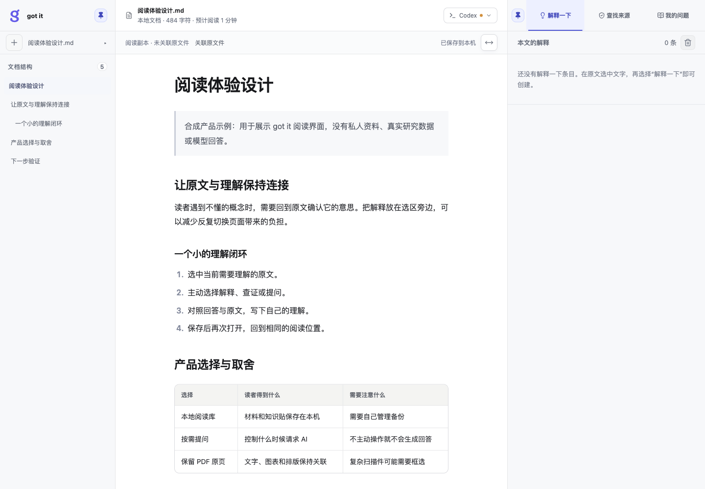
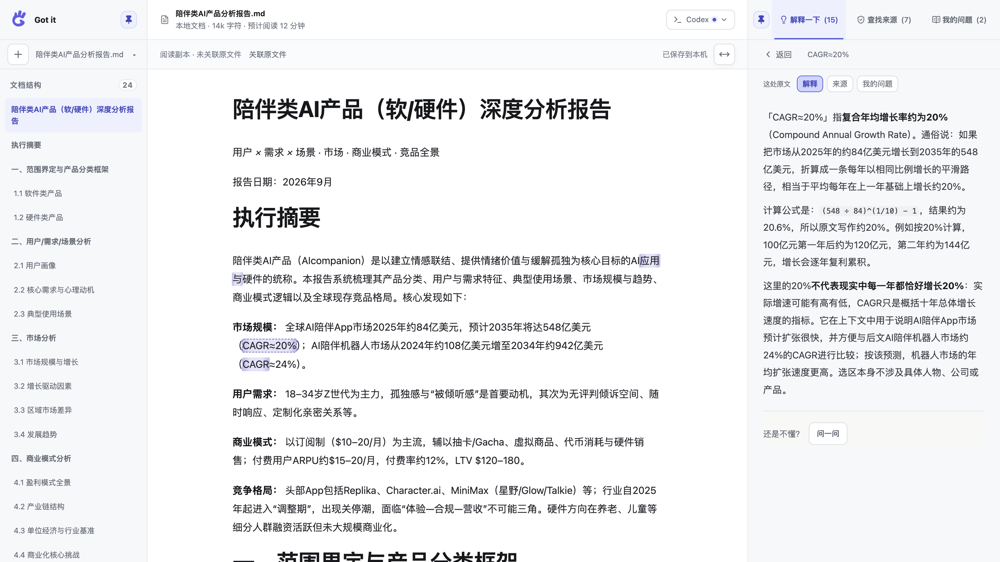
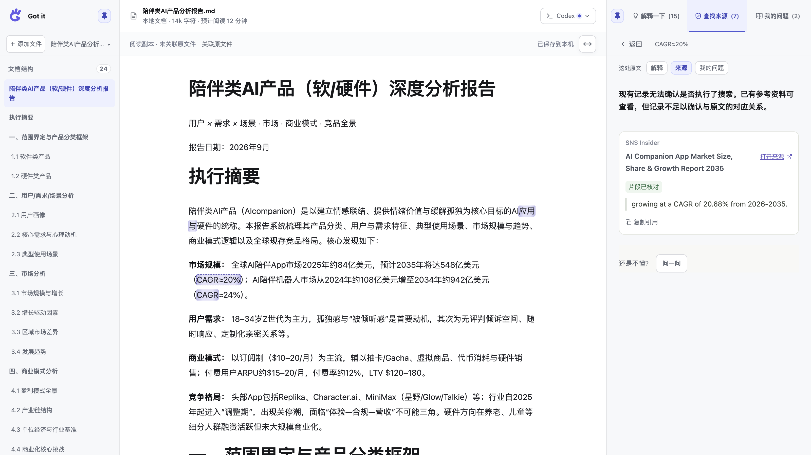
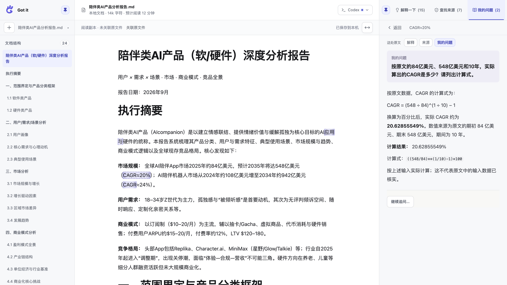
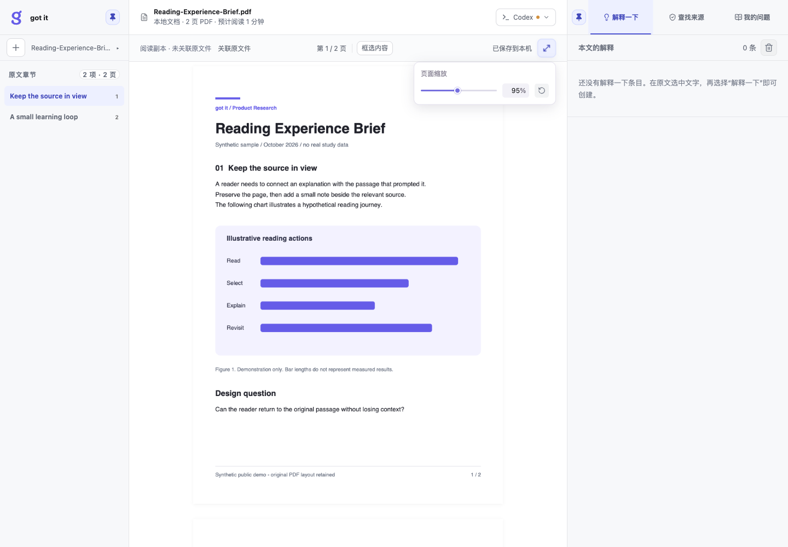
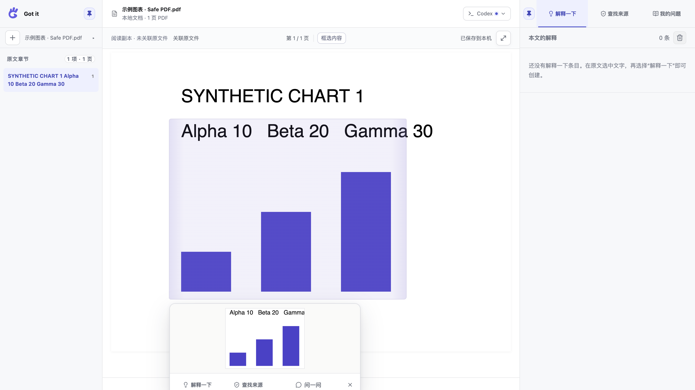
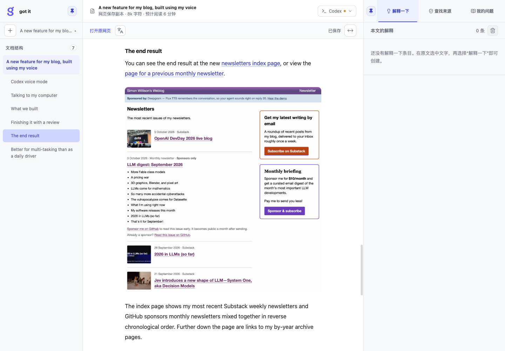
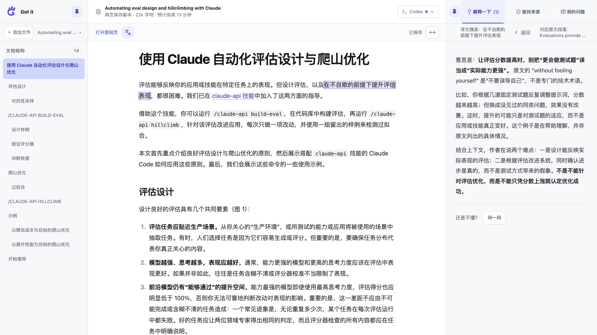

# got it

[简体中文](README.md) · **English**

**Make sense of it without leaving the page.**

got it is a local-first reader for Markdown, PDF, and web articles. Add material to your reading library, select the original text, then explain a concept, check sources, or ask a specific question. Answers stay beside the passage as knowledge cards, ready to revisit after a refresh or in a later reading session.

AI normally runs only after you choose an action or send a question. If you previously enabled automatic translation, a newly confirmed English web entry starts translation under that preference. Original files remain unchanged; reading copies, cards, translations, and progress are stored locally.

> **v0.1.0 · Early preview.** Best suited to readers already familiar with Codex. macOS Apple Silicon has been tested; Windows and Linux have not yet received native UI validation. got it has no accounts, cloud sync, or collaboration.

## A complete reading journey

The current Markdown, PDF, and illustrated web reading screenshots were captured on **October 14, 2026** with an isolated library, showing the lowercase brand and purple g mark. Markdown and PDF use synthetic samples. The web article is [Simon Willison’s public post](https://simonwillison.net/2026/Oct/9/built-using-my-voice/), imported through its real URL with saved static images. No model requests were made. Knowledge-card responses and the PDF selection view retain their October 12 interface and previously saved real responses; they do not show the current brand styling. Assess figures and answers in the examples independently.

### 1. Keep every format in one library

Markdown files, PDFs, and imported web articles coexist in the local library. The independent **+** button opens the add menu on hover; local files are labeled **MD / PDF** and web links **Static articles / X**. Click, keyboard, and touch remain supported, and leaving the combined button and menu area closes it. The adjacent library picker searches filenames or web article titles. Switching to an existing item does not generate an answer. Web entries retain their original URL, while local files show their source path or association state.

> The current brand is lowercase `got it` (`got-it` when hyphenated). See the [brand and reading showcase update](docs/updates/2026-10-14-brand-and-reading-showcase.md). The public repository is [Bing-Bryan/got-it](https://github.com/Bing-Bryan/got-it); existing `Got-it` data directories keep their original spelling.



### 2. Read beside the original

Use the outline on the left, read in the center, and revisit cards linked to selected passages on the right. Markdown keeps headings, lists, and tables; PDF retains its original page layout; imported web articles keep readable text, links, code, and required static images.


Each sidebar can be pinned or collapsed independently, and the card panel can be resized. Adjust Markdown content width or PDF zoom; reset PDF pages to automatic fitting when needed. Sidebars become drawers on narrow screens.

### 3. Select a passage and choose how to understand it

- **Explain:** clarify a term, person, company, product, or difficult passage, consulting outside material when necessary.
- **Find sources:** run one time-bounded lookup for a figure or claim, keeping search execution, excerpt checking, and evidential support as separate states.
- **Ask:** pose your own question about the selection, such as recalculating a growth rate or comparing two ideas.





This screenshot shows a saved historical record: its quotation excerpt was checked, but the old record cannot establish whether search ran at the time. The interface preserves that distinction; a checked excerpt does not establish the claim.



Continuous selections across paragraphs, headings, and lists also support Explain, Find sources, and Ask. The complete selection is sent with bounded context; oversized input is rejected explicitly instead of truncated. Explanations, sources, and questions for the same passage remain separate. Click the excerpt above a card to return to the original location. Finding a link does not establish a claim. Missing or unchecked excerpts stay explicit, and failures, interruptions, and completed lookups with no useful sources are never presented as success.

Use **Ask about the whole document** when the question concerns the broader material. Short documents provide all available text; long documents provide up to 16,000 characters of structure and relevant excerpts, with the coverage disclosed. A PDF without enough native text does not silently substitute OCR as document-wide input.

### 4. Select text or regions on the original PDF page

PDFs scroll continuously. The outline uses embedded bookmarks when available and otherwise detects headings locally. Select native text directly, or use **Select region** for scans, images, and complex layouts. Local recognition and the model request begin only after you choose Explain, Find sources, or Ask.





### 5. Save a web article and translate it when needed



Choose **+ → Web link** and paste a public HTTPS article URL. For ordinary web pages, got it extracts the static body and required images, then opens the article after saving a complete copy. Importing does not call a model. A saved copy remains readable when the source is temporarily unavailable. Adding the same URL again opens the existing entry without updating or translating it automatically.

**X content:** Paste an X/Twitter post or article URL into the same input and select **Read article**. Public articles, regular posts, and long posts are retrieved through FxTwitter. The service receives the public content ID and, when locating an article requires it, the public account name in the link—not your library, cards, or credentials. Source details retain the retrieval channel and saved scope; a service response is not independent verification of the complete original. Existing copies open without replacing their cards.

Complete text, code, supported tables, and successfully retrieved images are saved locally. An unavailable X image does not block reading: its position shows that it was not saved and offers a safe original-image link, while the save status distinguishes saved text from missing images. Images are not automatically refetched. If a missing image has a reliable public source address, you can explicitly retry it in place; success saves a local resource. Older records without such an address cannot be retried by guessing a URL. Embedded posts in articles retain an original-post link and an explicit notice that their body was not saved; no additional post is fetched. X videos retain an original-page playback link and attempt to save a local preview image when the source provides one; video files are not downloaded. Only the linked post and bounded quotes already included by the service are saved, without fetching an entire thread. An internal article ID that cannot be safely linked requires the original sharing-post URL. Articles with an account name use at most one bounded candidate page, without scanning the account. Older captures and their original source scope remain intact.



Non-Chinese text in imported web/X content can be translated explicitly. The language icon opens permission when no translation exists and otherwise switches saved original/Chinese views. Partial results keep **Translated X / Y text blocks** and **Continue translation** visible; only missing blocks are generated. If all blocks have arrived but saving failed, **Retry saving translation** writes existing results without regenerating them. An active run offers **Stop translation**.

Hover or keyboard focus on the count explains headings, paragraphs, list items, table cells, and split long paragraphs, without clicking. Counts increase only after validation; elapsed waiting time starts when this run begins and spans preparation, requests, and saving without resetting between batches. There is no simulated percentage. The first run explains what is sent. Checked batches survive stopping or failure. Switching saved reading views does not call a model; the original and card associations remain intact.

New translations and the missing parts of an explicit continuation use dedicated **gpt-6-luna / medium**, independently of Explain and Find sources preferences. If unavailable, translation fails explicitly instead of substituting another model. The prompt asks for natural, contextual Chinese while retaining the original meaning, qualifications, and formatting. Previously saved translations remain unchanged, including partial results from older models. Internal provenance records the configurations that actually contributed saved text. Structural validation cannot guarantee perfect semantics; check important terms against the original.

If a model drops formatting markers, only those failed text blocks are translated once more within the same batch deadline; valid blocks are not repeated. A failed repair preserves earlier results. Successful repairs show the count for the current run. Network errors, timeouts, and other detectable quality failures do not trigger this formatting repair, and user-facing errors do not expose internal diagnostic JSON.

Code blocks, inline code, link destinations, images, image alt text, and text inside images remain unchanged and are not sent for translation; ordinary figure captions may be translated as body text.

Local Markdown files, including the public samples, can also be translated on request. The entry point, permission, progress, continuation, and Original/Chinese switch match web pages. The source file is never changed; the translation is stored alongside the reading record, and if the original changes the old translation is no longer used and a notice explains why.

PDFs switch between original and Chinese as a whole with the same translate icon as web pages and Markdown; the choice is saved with the reading record and survives a refresh. Chinese is shown in place: the page is still the original PDF, and only translated paragraphs are replaced where they sit, while figures, images, formulas, vertical margin text, and untranslated paragraphs stay as they are. Chinese shrinks to fit each original paragraph box, one-line titles may narrow slightly, and anything that still does not fit ends with "…" that opens the full Chinese. On narrow screens the Chinese scales with the page like the original and can be zoomed. Only body paragraphs from pages with a text layer are sent: legends, table rows, and axis labels stay on the original page; web addresses in the text are kept verbatim and not sent; pages without a text layer show that they are images and cannot be translated yet (you can still select a region and ask), counting neither as failed nor complete; Chinese PDFs are not sent. Reading the PDF text layer happens locally and calls no model. Selecting Chinese text (within one paragraph) offers Explain / Find sources / Ask: only the selected Chinese and that paragraph's English original are sent, and the card is marked at that paragraph's place, locatable from either side. Limitations: paragraphs are inferred from the text layer, so formula-heavy passages may split into several paragraphs; short body lines near the top or bottom edge may be treated as headers or footers; long title-case headings may be skipped as non-body text; bookmarking inside the Chinese view is not supported yet; screen readers may still read the covered English in the Chinese view.

The existing automatic preference still applies only to newly confirmed English web entries; support for other languages does not expand that permission. Other languages require an explicit action.

Ordinary URL import targets readable static articles and cannot support every website. The X adapter depends on FxTwitter availability and structure. Private, deleted, mismatched or unrepresentable text and unsafe resources produce explicit errors, without signing in or inventing original text. Temporarily unavailable images retain explicit missing-image notices. Unavailable quotes retain an explicit state and original link instead of claiming their body was saved. Ordinary static import continues to reject signed-in pages, challenges, JavaScript-only bodies, and unsupported media. Static articles with reliable public text and a clear visible paywall boundary can save the public portion before that boundary, with a persistent scope notice; permission is no longer tied to one exact article URL. Login requirements, insufficient public text, or an unclear boundary still fail. Hidden or post-paywall content is not read, and required missing media still prevent one-click import.

### 6. Bookmark passages and find them by text

Select text and use the purple Bookmark icon at the left of the selection toolbar to save locally, without AI. Continuous selections can span paragraphs, headings, and lists. A successful save closes the toolbar and adds a light source marker; a failure stays explicit and can be retried. PDF bookmarks use trustworthy existing text only; bookmarking does not recognize images or start OCR.

The top Bookmark icon opens bookmarks for the current document. **All bookmarks** at the bottom of navigation opens the global list. The document popover shows three-line summaries; the global list shows complete excerpts, surrounding text, source, and time. Search matches excerpt or context text, with recent bookmarks first. Both lists support confirmed deletion, updating counts and current-source markers. **Locate source** opens the bookmarked version at its selection; **Back to reading** restores the prior reading position. If a version or position is unavailable, the saved snapshot remains readable with an explicit error.

Bookmarks and text search run locally without model calls. **AI semantic search is not implemented.** Bookmark records live in the local reading library and do not alter original files.

### 7. Wait for confirmed saving before leaving

The interface reports the actual persistence state: **Saving** while a write is pending and **Saved** after it succeeds, with some locations using the fuller **Saved locally** label. Translation progress and errors remain separate, so a completed translation cannot hide a pending or failed save. Failed saves can be retried. When records conflict, both versions are retained for review.

Buttons share consistent default, hover, pressed, disabled, selected, and keyboard-focus states while preserving the hierarchy among primary, secondary, and destructive actions. See the [UI guidelines](docs/ui-guidelines.md). To use the [button-state reference](docs/ui/button-states.html), download the repository and open the HTML file in a browser; GitHub does not run it directly on the page.

## AI, sources, and reader control

- Opening material, switching reading sides, expanding an input, or revisiting a saved card does not call a model. A previously enabled automatic-translation preference triggers only after a new English web entry is confirmed.
- Enter sends a question; Shift+Enter adds a line. Stopping, timing out, or failing preserves received content and offers retry.
- Selection requests send the selection, bounded nearby context, the title, and necessary card history. Only an explicit document-wide question or web translation prepares a broader corresponding input.
- Source checking reads a limited number of public pages without browser login credentials. It cannot guarantee the original source and does not add search rounds automatically.
- Knowledge-card tasks such as Explain and Find sources default to **GPT-6.1 SOL / medium**; web translation independently uses **GPT-6 Luna / medium**. AI settings read the model catalog returned by local Codex. An unavailable selection is reported instead of silently replaced.
- Reading-time estimates are computed locally. **Local storage does not mean offline AI.**

## Quick start

| Item | Current baseline |
| --- | --- |
| Node.js | **24.14.1, Node 24** (see `.nvmrc`) |
| npm | **11.x** |
| System | Tested on macOS Apple Silicon; Windows/Linux experimental |
| AI | A locally installed, signed-in Codex; model catalog supplied by Codex |
| Network | Required for installation, AI, web import, and source lookup |

Clone or download the repository and enter its directory. With nvm, run `nvm install` and `nvm use` first.

```bash
npm ci
npm run build
npm start
```

The browser opens <http://127.0.0.1:8787/>. Keep the terminal running and press Ctrl+C to stop. Later launches only need `npm start`; reinstall and rebuild after updating the code. Keep development dependencies because the local launcher uses `tsx`.

1. Open **AI settings** and check the Codex connection. If needed, follow the interface to official authorization or run `codex login` in a terminal.
2. Add a local Markdown/PDF file or a web link, or begin with the built-in example.
3. Select a passage or PDF region and choose Explain, Find sources, or Ask.
4. Wait until the interface confirms saving before closing; the next launch restores the reading record.

got it does not read, copy, or store Codex tokens. On macOS it prefers the executable from Codex.app / ChatGPT.app, then `codex` on PATH. `CODEX_CLI_PATH` can specify another executable.

For development:

```bash
npm run dev
```

The frontend runs at `127.0.0.1:5173` and the API at `127.0.0.1:8787`. Set `BROWSER=none` to suppress automatic opening; PowerShell uses `$env:BROWSER="none"`. The app does not load `.env` automatically; `.env.example` documents configuration.

## Storage and privacy

- Markdown and web text copies, static web media, PDF copies, recognition assets, crops, cards, bookmarks, translations, answers, and learning state are stored on disk. Original files remain unchanged. Browser storage holds preferences and emergency recovery data only.
- Default data directories: macOS `~/Library/Application Support/Got-it`; Windows `%LOCALAPPDATA%/Got-it`; Linux `$XDG_DATA_HOME/got-it` or `~/.local/share/got-it`. Override with `GOT_IT_DATA_DIR`, and run only one service per data directory.
- PDF OCR runs locally with Simplified Chinese and English assets prepared during installation. Image explanations send the crop you confirmed to the model.
- Local saving is not an off-device backup. Stop the service and back up the complete application data directory for important work. Do not clear browser data to address a save problem.
- The local API listens on loopback by default. **Do not expose it to the public internet.** GitHub Pages cannot replace the local API.

## Current limitations

- Codex only, requiring your own account, network access, and available quota. One document is expanded at a time. No Word support, source-text editing, accounts, cloud sync, or collaboration.
- PDFs must be unencrypted, at most 50 MiB and 200 pages. OCR initially covers Simplified Chinese and English with a 60-second limit per task. Complex layouts, figures, and small text can be misread; check the original page. Crops are limited to 8 MiB and 4096 pixels on the longest side.
- Generated PDF outlines can omit or misread headings and cannot currently be edited. Document-wide questions may also miss parts of long material.
- Web import saves only reliably extracted static text and supported media; it does not run source-site interactions. Dynamic WebP, APNG, and video are unsupported, and ambiguous structures may be rejected. Media limits fail explicitly rather than silently truncating content.
- Local relative images in Markdown are not yet supported. Major source changes may require relocating existing card anchors.
- There is no backup-download button. PDF and web records require the full application data directory. Legacy Focus Stickies workspaces, `.focus` files, and complete JSON exports remain importable.
- A saved answer does not imply understanding or verification. Cancellation, disconnection, and timeout are never replaced with demo answers.

## Development and release checks

```bash
npm test
npm run build
npm run test:release
npm audit --audit-level=high
```

`build` includes TypeScript checking. `test:release` uses temporary data to verify the built page, static assets, local service, and API boundaries without model calls. See the [release checklist](docs/release-checklist.md), [recorded release results](docs/release-results.md), and [security notes](SECURITY.md).

Maintainers use `npm run release:prepare` to create an allowlisted public snapshot, then sync it to the separate public repository. Do not push the internal development repository directly. Review screenshots and text separately before publishing.

## License

Project code uses the [MIT License](LICENSE). Third-party names, marks, and material excerpts in screenshots illustrate the product and imply neither endorsement nor a license to redistribute the underlying content.
